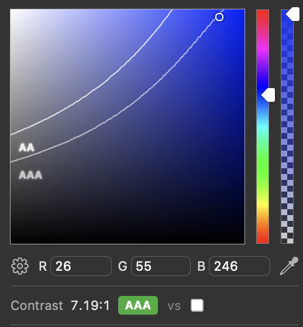

So I did a redesign on this website the other day. I do this probably more often than I'd need tothe last version of each redesign is [tagged](https://github.com/danielroelfs/danielroelfs.com/tags) in the [GitHub repo](https://github.com/danielroelfs/danielroelfs.com/tags), but I do it because I enjoy it. It's not necessarily that I get tired of the previous design, but I probably got bored, got some inspiration somewhere on graphic design or typography, and decided now is a good time to try it out on my website. But I felt this iteration of the redesign was a bit different. I felt the urge to put in a lot of effort to differentiate my own website design from those generated with AI, and writing about _why_ I felt that way might help me make sense of where that feeling comes from.

## Second nature and keeping distance

As I was having fun tinkering with the design, trying out different styles, and trying to express in [Sass](https://sass-lang.com) what I had in mind for the style and layout I realized two things. First, when I got stuck, it was very tempting to take the shortcut and ask Claude to help me solve it, trusting it would give a good enough answer almost immedately, eliminating the need to parse answers on [StackOverflow](https://stackoverflow.com/) and apply them to my use case. At work I'll use LLMs where they help the quality of my work and make me more effective and efficient, but this website is my personal hobby project, so I try to keep up the fundamentals here. But the tendency to "automatically" ask Claude is definitely there. And while I think it's definitely fine to use all tools at your disposal if you know how to use them in a good way, I'm a bit more afraid when tools that take over too many cognitive tasks become second natureI never claimed any of my ramblings here are original.

The second thing I realized was that during the design process I was afraid that anything I'd build would look like AI "slop" created through vibe coding. I'm by no means a professional graphic designer, web designer or designer of any other kind, I just enjoy tinkering with stuff. This isn't a worry I have at work where I'm working in a programming discipline I'm more trained and experienced in. So when I was working on the new design of the website, one of my main concerns was about having it not _look_ like AI slop, despite the fact that I can comfortably state that none of it _is_ AI slop. And talking to my programmer friends and colleagues, I'm not the only one who has had this thought (again, I'm not claiming to be original here). So in order for me to be able to feel proud of the website I created I need to specifically _stay away_ from the design quirks that the design from vibe-coded website fall into. And as more and more "content" on the web is generated or edited using AI, will there be more and more quirks that people that want to carve out a niche feel they need to avoid?

## The uncanny valley

People are very confident about their ability to spot AI generated content. In my experience they're often wrong. My current job is quite literally to help identify AI generated images and documents as part of fraudulent insurance claims and my perception deceives me more than I'd like to admithey, that's why I'm a data scientist so I can at least rely on the data. Nonetheless, humans have developed a sixth sense about spotting (poorly-executed) AI, as they have for anything that occupies the ["uncanny valley"](https://en.wikipedia.org/wiki/Uncanny_valley). For me, this has caused me to consciously think about if the design I'm creating gives off these "uncanny valley"/AI vibes. Which I found strange since that seems to imply that there is some "inherent" AI-like design hallmarks that should be avoided. One can always prompt their way out of this uncanny valley I supposeand of course people have developed [Claude skills](https://github.com/funboy322/avoid-ai-design) to do just that, but I still found it strange that I felt the need to be so consciously aware of it. It feels as if one cannot be proud of their work until they've successfully established themselves on the good side of the uncanny valley.

I wonder if the uncanny valley is getting smaller as the AI models get better and better at simulating realistic imagery and when users get better at prompting models to get the output they want. And what does that mean for real designersi.e. not amateurs like me that want to distinguish themselves from AI? Sticking with the "valley" visual, do designers need stay further and further away from the cliff as it becomes easier for the LLMs to "jump" across the valley? Would they get pushed further and further into niches? Do designers need to put in more-and-more effort to adequately distinghuish themselves from AI? I still feel this urge to set myself apart from the AI-assisted or AI-driven designPerhaps borne out of a feeling of superiority? I'm not proud of it, will this still persist a few years from now? I have no answers, but I'm curious as to what the answers will turn out to be.

## Show the process

So AI generated code and design is spreading across the internet. [Cloudflare estimates](https://radar.cloudflare.com/traffic?dateRange=24w#bot-vs-human) that bots already make up most of the traffic on the web, and it seems it's only a question of time before content generated by bots exceeds that exceeded of humans also. So how do those that feel the need to set themselves apart?

My strategy has been to _show the process_ rather than just the result&ast;. But that only works if there's a natural possibility to show the process alongside the design like it is in these kinds of personal websites. Otherwise one could possibly be a bit more vocal about sharing where one gets inspiration from on social media so there's some degree of provenance in the designs. In addition, it's a nice way to support other creators by giving them a shoutout when you can.

An alternative strategy is to make something so outside of the established design norms that it can only come from the chaos that is the human mind, rather than a mathematical model like LLMs. The concept of [Anti-Design](https://blog.artsper.com/en/a-closer-look/art-movements-en/anti-design-italian-movement/) is decades old, but it has made a [revival](https://twosstudio.com/articles/what-is-anti-design-and-why-its-coming-back-in-the-age-of-ai) in the age of AI. The appeal seems to be growing due to a desire to be distinctively human. No AI would make design choices this deliberately counter-conventional. I think it is in this desire to stand out as explicitly human by making unusual and unpredictable choices that the design for the website in its current formAt time of writing: 2026-11-08 materialized.

So am I proud of the somewhat jarring, odd, and possibly charmingly ugly design of this website? Yes, because I can call it my own. The design is my own, the bugs that I probably introduced are my own, the lack of responsivity to adjust to the screen of the 2016 iPad Pro with the 9.7 inch screen is because I didn't think to create a separate [media query](https://developer.mozilla.org/en-US/docs/Web/CSS/Guides/Media_queries/Using) for it is also my own fault. I know that I could have easily asked Claude to help me solve some of these issues is, but the choice not to is also my own. This website is my own little corner on the internet, and it doesn't need to be AI-perfect. I just want it to be explicitly human. I won't ask anyone to put effort into reading something I didn't put effort into writing myself.





&ast; For the redesign for this website I could for example talk about all the typefaces I tested for the monospace text. How I wanted to evoke the style of old programming style guides by using a typeface like [TX-02 Berkeley](https://usgraphics.com/products/berkeley-mono)but I didn't want to pay $225 to use a typeface that it mostly decorative and I most likely won't use here 1-2 years from now. When I pay for a typeface I need to know I'll get some mileage out of it (released in 2022 though), how [Fonts In Use](https://fontsinuse.com/typefaces/242584/berkeley-mono) recommended [Input Mono](https://input.djr.com) or [JetBrains Mono](https://www.jetbrains.com/lp/mono/) instead, but that after testing those it didn't quite fit the vibe I was going for, so after some other testing I chose [Geist Mono](https://vercel.com/font?type=mono) instead.

How I probably got the inspiration for the intense blue color on the home page from the [Data Visualization Handbook](https://www.datavizhandbook.info) I had been looking into recently, but that I wanted to keep the style of 60s programming and chose a color more closely to that of the [blue screen of death](https://en.wikipedia.org/wiki/Blue_screen_of_death). How I spent an embarrasingly long time picking the specific hue of the background color to get it exactly how I wanted it, and in the process discovered that Safari has a built-in color pickerThe Safari color picker shows the contrast thresholds for [web accessibility](https://webaim.org/resources/contrastchecker/?fcolor=1A37F6&bcolor=FFFFFF):  that shows the contrast levels with the text color to make it easier to ensure [accessibility](https://webaim.org/resources/contrastchecker/?fcolor=FFFFFF&bcolor=1A37F6). How I didn't want to change the background color of the article body text itself because I still believe black on white reads better for long-form text, and to make sure the white background in many of the plots in others posts wouldn't be so jarring against the blue background.

I'd mention how I got inspired for the logo on the home page by old corporate logos using an abstract globe, kinda like (Norwegian foreign aid organization) [Norad's logo](https://www.norad.no/om-norad/kontakt/logo/) still does today. How I probably got the initial idea for the logo from a [website](https://マリウス.com) with the a domain name I didn't even know was supported: [マリウス.com](https://マリウス.com). How the developer of that website probably got inspired by the old [AT&T logo used in the 80s and 90s](https://logos.fandom.com/wiki/AT%26T#1983–1999). How I tried to design the SVG first in Affinity Designer for a while, but that I wasn't satisfied, so I tried to generate it in SVG directly, which didn't quite work as I had intended, but that I liked the resulting logo better than what I'd had managed to create myself, and so on.
